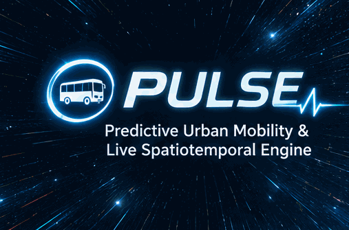
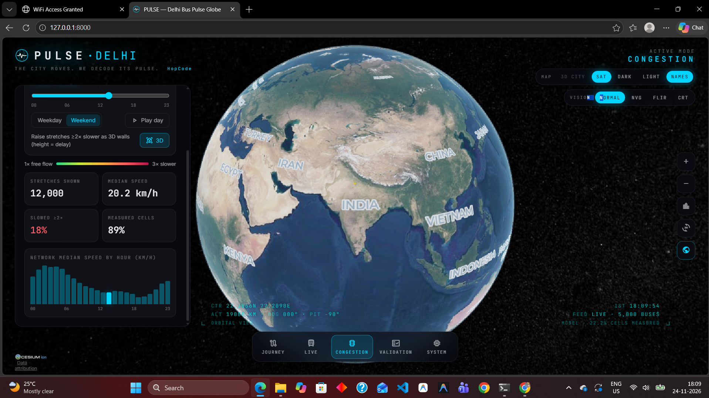
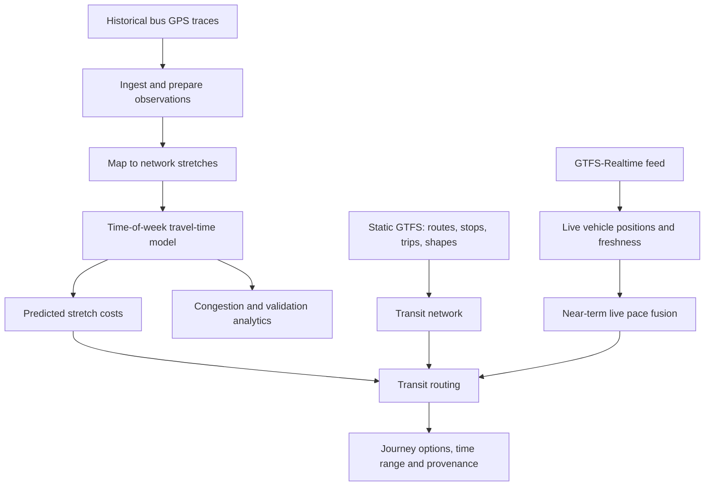

<div align="center">



# 🚌 PULSE
### Predictive Urban Mobility & Live Spatiotemporal Engine

**The City Moves. We Decode Its Pulse.** 🌆

[](#-team-hopcode)
[](#-hackathon-context)
[](#-hackathon-context)
[](#-technology-stack)
[](#-known-limitations)

**A data-driven Delhi DTC bus traffic model, live fleet view and time-aware journey planner.**

</div>

---

## 🌍 The idea

A bus timetable tells you when a bus is *scheduled* to move. The city tells a different story.

**PULSE** turns historical bus GPS traces and available GTFS / GTFS-Realtime data into a spatiotemporal view of Delhi's bus network. It estimates travel time across bus-route stretches, uses those estimates inside a journey planner, and presents the result through a map-first interface with a 3D globe experience.

The prototype was built around **31 days of October 2026 bus GPS data** (approximately **920 million raw rows**) and a network model containing **163,018 road stretches**.

> 🚦 **The goal:** move beyond timetable-only estimates and make bus journey planning responsive to how the network behaves across routes, days and times.

> 🎞️ **About the animation:** the GIF above is generated concept artwork for the repository. It is not a screen recording, a live map, or evidence of actual UI behaviour. Use the nine screenshot slots below for genuine captures from the running application.

## 📊 Held-out validation

The reported evaluation uses a chronological split: train on **1–24 October 2026** and evaluate on **25–31 October 2026**, using **10,500 real bus runs** from the held-out days.

| Predictor | Evaluation coverage | Mean absolute error | Median absolute error | Within ±20% |
|:--|--:|--:|--:|--:|
| **PULSE model** | **10,500 runs** | **4.61 min** | **2.47 min** | **63.7%** |
| Flat average bus speed | Reported baseline | 6.77 min | 4.54 min | 38.6% |
| Static GTFS timetable | 41.8% of held-out runs matched | 6.57 min | 4.23 min | 39.9% |

- 🎯 The actual travel time fell inside the PULSE prediction range in **84.2%** of evaluated runs.
- ⚖️ On the subset of runs that matched a GTFS timetable, PULSE recorded **4.25 min MAE** on those same runs.
- 🧪 The comparison with Google Routes has **not** been run. `scripts/compare_google.py` is prepared for an optional, billed Routes API benchmark.

See [`docs/VALIDATION_REPORT.md`](docs/VALIDATION_REPORT.md) and [`data/validation/results.json`](data/validation/results.json) for the recorded evaluation output and methodology.

<sub>These are offline, historical hold-out results from the supplied October 2026 dataset. They are not a guarantee of future live accuracy. The timetable row covers only the trips that could be matched to GTFS; it should not be interpreted as a full-coverage comparison.</sub>

## ✨ What PULSE brings together

<table>
<tr>
<td width="50%">

### 🚌 Live fleet intelligence

- GTFS-Realtime vehicle positions from Delhi Open Transit Data.
- Vehicle heading derived from movement.
- Freshness-aware vehicle presentation.
- Live route pace can influence journeys departing soon.

</td>
<td width="50%">

### 🧭 Journey planner

- Stop / place / coordinate search.
- Direct and one-transfer bus journeys.
- Predicted in-vehicle time with a likely range.
- Walk, wait and ride breakdowns, plus data provenance.

</td>
</tr>
<tr>
<td>

### 🚦 Spatiotemporal congestion

- **163,018** modelled stretches.
- **96** fifteen-minute buckets per day type.
- Weekday / weekend patterns.
- Congestion index and time-of-day comparison.

</td>
<td>

### 🌐 3D globe experience

- CesiumJS globe and Delhi fly-in.
- Satellite, dark and light map options.
- 3D route and congestion visualisations.
- Optional visual treatments and HUD styling.

</td>
</tr>
<tr>
<td>

### 📈 Validation dashboard

- Held-out model metrics.
- Time-of-day, day-type and trip-length views.
- Historical baseline comparisons.
- Model coverage and prediction provenance.

</td>
<td>

### 🧩 Explainable estimates

- **22.2%** of stretch × time cells are direct GPS measurements.
- Remaining cells use documented fallback sources.
- Provenance is retained per cell.
- No manually typed speed tables are used by the described model pipeline.

</td>
</tr>
</table>

## 🖼️ Application screenshots — 9 gallery slots

Replace each labelled slot with a **real screenshot captured from your running PULSE application**. Keep the filenames below so the gallery can be enabled without changing the layout.

<table>
<tr>
<td align="center" width="33%"><strong>01 · 🌐 3D Globe</strong><br/><br/>📸 Add screenshot 01<br/><code>01-globe.png</code></td>
<td align="center" width="33%"><strong>02 · 🛰️ Satellite View</strong><br/><br/>📸 Add screenshot 02<br/><code>02-satellite.png</code></td>
<td align="center" width="33%"><strong>03 · 🚌 Live Fleet</strong><br/><br/>📸 Add screenshot 03<br/><code>03-live-fleet.png</code></td>
</tr>
<tr>
<td align="center"><strong>04 · 🧭 Journey Planner</strong><br/><br/>📸 Add screenshot 04<br/><code>04-journey-planner.png</code></td>
<td align="center"><strong>05 · 🚦 Congestion Map</strong><br/><br/>📸 Add screenshot 05<br/><code>05-congestion-map.png</code></td>
<td align="center"><strong>06 · 🏙️ 3D Congestion</strong><br/><br/>📸 Add screenshot 06<br/><code>06-congestion-3d.png</code></td>
</tr>
<tr>
<td align="center"><strong>07 · 📊 Validation</strong><br/><br/>📸 Add screenshot 07<br/><code>07-validation.png</code></td>
<td align="center"><strong>08 · 🧮 Route Details</strong><br/><br/>📸 Add screenshot 08<br/><code>08-route-details.png</code></td>
<td align="center"><strong>09 · 🖥️ System Status</strong><br/><br/>📸 Add screenshot 09<br/><code>09-system-status.png</code></td>
</tr>
</table>

Once the nine files are added to `docs/assets/screenshots/`, replace each placeholder cell with an image, for example:

```html

```

## 🧠 How the engine works

PULSE combines three information layers:

1. **Historical GPS** builds observed travel-time behaviour for stretches and time buckets.
2. **Static GTFS** provides the route, stop, trip and shape structure used by transit routing.
3. **GTFS-Realtime** provides current vehicle positions and movement context for the live fleet view and eligible near-term journeys.

The journey planner uses the model's stretch-level travel-time estimates inside a direct / one-transfer routing flow. Estimated journey time is composed from walking, waiting and in-vehicle components.



### 🔬 Model resolution

| Dimension | Current implementation |
|:--|:--|
| Network | 163,018 road / route stretches |
| Time buckets | 96 × 15-minute buckets per day type |
| Day types | Weekday and weekend |
| Directly measured cells | 22.2% of stretch × time cells |
| Other cells | Fallback estimates borrowed from other times / route / network levels, with source recorded |

Illustrative weekday network speeds reported by the model: **~27 km/h at 02:00**, **~15 km/h around midday**, and **~12 km/h at 18:00–19:00**. These are model outputs, not a claim that every route or road moves at that speed.

## 🧰 Technology stack

| Layer | Technologies |
|:--|:--|
| Backend and API | Python, FastAPI, Uvicorn |
| Data and storage | SQLite, DuckDB, Parquet, NumPy / Pandas tooling |
| Transit data | GTFS Static, GTFS-Realtime |
| Routing and modelling | RAPTOR-style transit routing, stretch-level travel-time model |
| Frontend | HTML, CSS, JavaScript |
| Maps and visualisation | CesiumJS, map tile providers, 2D / 3D map layers |
| Quality | Pytest, held-out historical evaluation |

## 🚀 Run locally

### 1. Clone the repository

```powershell
git clone https://github.com/heysayanallgood/PULSE.git
cd PULSE
```

### 2. Create the Python environment

```powershell
python -m venv .venv
.\.venv\Scripts\Activate.ps1
python -m pip install --upgrade pip
python -m pip install -r requirements.txt
```

### 3. Configure environment variables

```powershell
Copy-Item .env.example .env
```

Edit `.env` and add the credentials required for the services you enable:

| Variable | Purpose |
|:--|:--|
| `OTD_API_KEY` | Delhi Open Transit Data access for the live feed |
| `LIVE_FEED_ENABLED` | Enable / disable live-feed integration |
| `GOOGLE_MAPS_API_KEY` | Optional Google map tiles and the separate Routes benchmark |
| `MAPTILER_API_KEY` | Optional MapTiler map layers |
| `CARTO_API_KEY` | Optional CARTO integration, if required by your configured layer |
| `GEOAPIFY_API_KEY` | Optional Geoapify services |

🔐 **Never commit `.env` or expose the private OTD key in browser code.** Restrict browser-facing map-provider keys to the required domains / APIs and quotas.

### 4. Start the API and web application

```powershell
python -m uvicorn app.main:app --host 127.0.0.1 --port 8000
```

Open **http://127.0.0.1:8000**. Interactive API documentation is available at **http://127.0.0.1:8000/docs**.

> 📦 **Data prerequisite:** raw GPS archives and large derived databases / model artefacts are intentionally not included in this Git repository. A complete local run requires the relevant data and generated artefacts to be prepared. Follow [`docs/TRAFFIC_MODEL.md`](docs/TRAFFIC_MODEL.md), [`plan.md`](plan.md) and [`walkthrough.md`](walkthrough.md) for the project workflow. The command above starts the application; it does not download the October GPS archive automatically.

## 🧪 Rebuild and test

Run the test suite:

```powershell
python -m pytest tests
```

The project documentation describes a 53-test suite; run it locally to verify the current checkout and environment.

The full pipeline script is Bash-oriented. Run it from **Git Bash or WSL** after preparing the source data:

```bash
PY=python bash scripts/run_pipeline.sh
```

Optional Google Routes comparison (uses a billed API):

```bash
python scripts/compare_google.py --pairs 60
```

The Google comparison is **not yet part of the reported validation results**; do not describe PULSE as outperforming Google Maps until the benchmark has been run and its methodology/results are documented.

## 🔌 API surface

| Endpoint | Purpose |
|:--|:--|
| `GET /api/v1/journeys?from=&to=&depart_at=HH:MM:SS&date=` | Direct / one-transfer journey options, estimates, ranges, provenance and geometry |
| `GET /api/v1/analytics/congestion?hour=&is_weekend=` | Congestion index by stretch |
| `GET /api/v1/analytics/time-comparison?route_id=` | Corridor comparison across hours |
| `GET /api/v1/analytics/model` | Model coverage and training days |
| `GET /api/v1/vehicles` | Live buses and freshness data |
| `GET /api/v1/places/autocomplete?q=` | Stops, places and coordinate search |
| `GET /api/v1/validation/summary` | Historical validation summary |
| `GET /api/v1/system/status` | Data, storage, feed and model status |

## 🗂️ Repository map

```text
PULSE/
├── app/                 # FastAPI app, APIs, routing, services and models
├── frontend/            # HTML, CSS, JavaScript and globe experience
├── scripts/             # Model build, ingestion, Google benchmark and pipeline
│   ├── dev/             # Development / diagnostic utilities
│   └── legacy/          # Superseded pipeline implementations for reference
├── docs/                # Model method, validation and demo documentation
│   └── assets/          # README showcase GIF and screenshot gallery
├── data/                # Small tracked validation output; large data is excluded
├── tests/               # Unit and integration tests
├── .env.example         # Safe configuration template
└── requirements.txt     # Python dependencies
```

## ⚠️ Known limitations and honest boundaries

- 🚌 The router currently searches **direct and one-transfer** journeys; two-transfer search is not implemented.
- 🧩 Rarely operated route variants have sparse GPS observations and rely more heavily on fallback estimates. The model records the source of an estimate.
- 🧾 Feed trip IDs do not match GTFS trip IDs in all cases; the timetable baseline matched **41.8%** of held-out runs.
- 📡 Live-fusion replay / backtesting has not been completed. The current live-fusion path applies only to departures within **30 minutes** of now.
- 🗺️ Google Photorealistic 3D Tiles are optional and currently require the relevant Google Map Tiles API configuration to be enabled. The Routes API benchmark is separate and has not been run.
- 📉 Only **22.2%** of stretch × time cells are direct measurements; the remaining values are explicitly sourced fallbacks, not direct observations for every cell.

## 📚 Project documentation

- 🧠 [Traffic model and methodology](docs/TRAFFIC_MODEL.md)
- 📊 [Validation report](docs/VALIDATION_REPORT.md)
- 🎤 [Hackathon demo script](docs/DEMO_SCRIPT.md)
- 🧭 [Feature walkthrough](walkthrough.md)
- 🗺️ [Project plan](plan.md)
- 🧾 [Recorded validation results](data/validation/results.json)

## 🤝 Team HopCode

Built for **Transport Stack Hackathon 2026 — Phase 1, Problem 1: Real-Time Bus Traffic Model and Journey Planner**.

### Data acknowledgement

Data references and project context: **Transport Stack and IIIT Delhi, with DTC and ONDC**, as identified in the project materials.

---

<div align="center">

### 🚌 The City Moves. We Decode Its Pulse. 💙

**PULSE · Team HopCode · Delhi, India**

</div>
