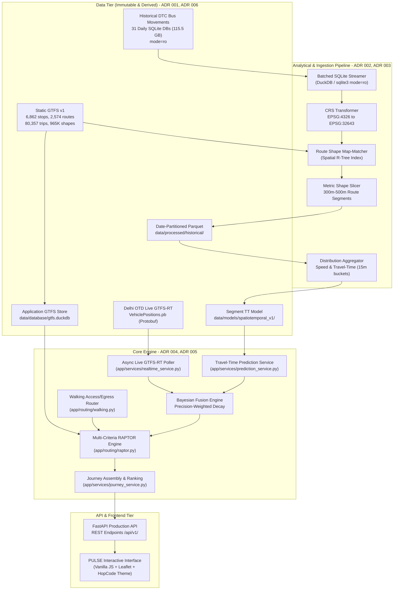

# PULSE — System Architecture Document
**Project:** Predictive Urban Mobility & Live Spatiotemporal Engine  
**Team:** HopCode | **Hackathon:** Transport Stack Hackathon 2026 (Problem 1)  
**Authoritative Architectural Alignment:** ADR 001 through ADR 006  
**Workspace:** `E:\Pulse` on SanDisk 2 TB Portable SSD (Drive `E:`)  

---

## 1. Architectural Overview & Design Philosophy

PULSE is engineered as a high-performance, modular spatiotemporal engine designed specifically to decode the actual movement of Delhi's bus fleet and provide accurate, congestion-aware journey planning.

### Fundamental System Principles
1. **Separation of Transit Topology from Travel Times (ADR 004)**: Static GTFS schedules define network connectivity (which routes run where, which stops are served in what sequence, and when service days begin). They do **not** define real-world road speeds. PULSE's travel-time model overrides in-vehicle segment durations with observed movement distributions.
2. **Empirical Grounding & Data Provenance (ADR 002, ADR 006)**: Every predicted travel time and journey leg is traceable back to its underlying evidence source (`LIVE`, `HISTORICAL`, `LIVE + HISTORICAL`, `SCHEDULE-BASED`, `FALLBACK`). Under no circumstances is artificial or simulated traffic injected.
3. **Storage & Hardware Isolation (ADR 001)**: Host drive `C:` (only 4 GB free) is strictly protected. All analytical compute, temporary directories (`TEMP`, `TMP`), DuckDB swap, pip download cache, and Parquet stores reside on `E:\Pulse` (793 GB free).
4. **Metric Space Operations (ADR 003)**: All distance, speed, and map-matching calculations are performed in projected Cartesian space using EPSG:32643 (UTM Zone 43N).
5. **Multi-Criteria Optimization (ADR 004)**: Commuters care about arrival time, transfer count, and walking distance. PULSE generates Pareto-optimal journeys rather than optimizing a single weighted metric.

---

## 2. High-Level Component Architecture

---

## 3. Core Subsystems

### 3.1 Data Ingestion & Storage Subsystem
- **Historical Ingestion**: Sequentially processes 31 daily SQLite databases using read-only connections (`mode=ro`). Normalizes Unix UTC timestamps and extracts IST temporal attributes (`hour`, `minute`, `day_of_week`, `is_weekend`, `bucket_15min`).
- **Storage Layout**: Snappy-compressed columnar Parquet files organized hierarchically:
  `data/processed/historical/year=2026/month=10/day=DD/part-*.parquet`.
- **Application GTFS Store**: Fast indexed DuckDB database `data/database/gtfs.duckdb` enabling sub-millisecond retrieval of route stops, trips, service calendars, and shapes.

### 3.2 Geospatial & Map-Matching Subsystem
- **Metric Projection**: Projects geographic WGS 84 coordinates to UTM Zone 43N (EPSG:32643) using PyProj with `always_xy=True`.
- **Shape Segmentation**: Slices continuous GTFS polyline shapes into 300m–500m contiguous metric segments aligned to bus stops.
- **Route-Constrained Matching**: Uses candidate shape filtering based on observed `route_id`, projecting pings orthogonally onto shape segments and tracking distance-to-shape. Pings with offset $> 50$ meters or speeds $> 25$ m/s are rejected as GPS noise.

### 3.3 Spatiotemporal Travel-Time Subsystem
- **Dual Distributions**: Stores both segment speed distributions (m/s) and segment traversal travel-time distributions (seconds).
- **Temporal Partitioning**: 15-minute time buckets (96 bins/day) partitioned by weekday vs. weekend.
- **Hierarchical Fallback**: Provides high-confidence predictions when samples are dense ($N \ge 30$), falling back smoothly to 1-hour windows, route-level rates, or network priors when observations are sparse.
- **Uncertainty Bounds**: Reports median, 10th percentile (free-flow traffic), 90th percentile (heavy congestion), and sample standard deviation.

### 3.4 Live GTFS-RT Fusion Subsystem
- **Consecutive Ping Tracking**: Calculates instantaneous bus velocity from consecutive pings of the same vehicle along the shape corridor.
- **Precision Weighting**: Fuses live observations with historical distributions using inverse-variance precision weighting with exponential freshness decay ($\tau = 60\text{s}$, maximum cutoff 120s).
- **Graceful Failure**: If the live feed is offline or unauthenticated, the system continues functioning on historical models with zero downtime and explicit `HISTORICAL` badges.

### 3.5 Multi-Criteria RAPTOR Transit Routing Subsystem
- **Pareto Exploration**: Computes optimal journeys across Arrival Time, Transfer Count, and Walking Duration.
- **Dynamic Segment Travel-Time Injection**: In-vehicle travel times between consecutive stops are dynamically computed by querying the travel-time model for the predicted departure time, replacing static GTFS timetable durations.
- **GTFS Midnight Extension**: Accurately parses and computes arrival times for late-night services with GTFS times $> 24:00:00$.

### 3.6 API & Web Presentation Subsystem
- **FastAPI Layer**: Structured Pydantic V2 request/response validation, OpenAPI/Swagger documentation, and clean error handling.
- **Modern Interactive UI**: Map-based journey planning with Leaflet, Traffic Time Machine slider, Live DTC bus tracking, and Validation Laboratory.
