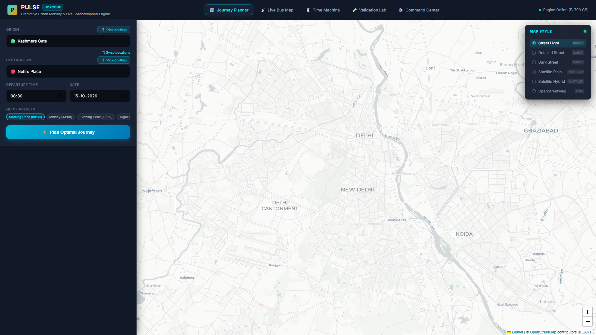
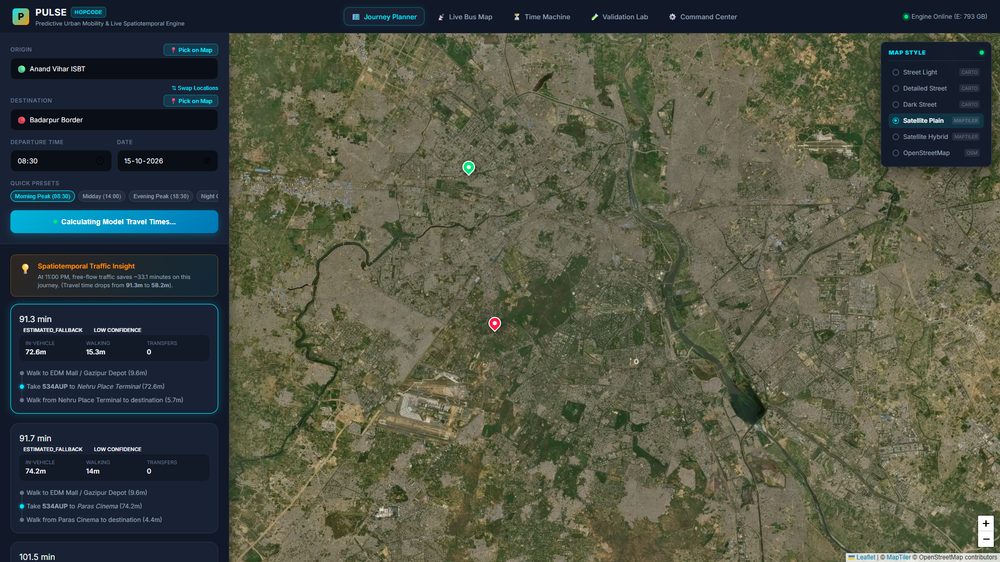
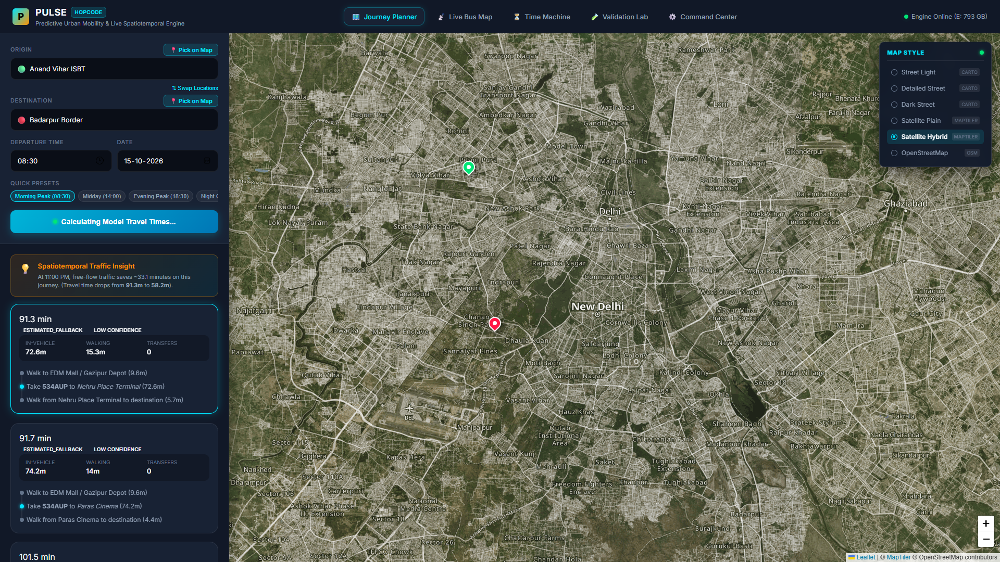

# PULSE — Final Map Layer Implementation & Satellite Integration

## Overview
This document records the complete architecture, implementation, and verified browser acceptance of the multi-style map system in PULSE, providing seamless switching between Light Street, Detailed, Dark Matter, Satellite Plain, Satellite Hybrid, and OpenStreetMap.

## 1. Map Layer Architecture & Providers
- **Default Street Basemap**: CARTO Positron (`rastertiles/light_all`) rendered with authenticated developer API key (`cb1_5d19_1_258c3b9d8e04bf2290f574b2`) passed via `?key=` query parameter.
- **Detailed Street Basemap**: CARTO Voyager (`rastertiles/voyager`) with authentic attribution.
- **Dark Matter**: CARTO Dark Matter (`rastertiles/dark_all`).
- **Satellite Plain**: MapTiler Satellite v4 (`https://api.maptiler.com/maps/satellite-v4/{z}/{x}/{y}.jpg?key=...`) with seamless ArcGIS World Imagery fallback.
- **Satellite Hybrid**: MapTiler Hybrid (`https://api.maptiler.com/maps/hybrid-v4/{z}/{x}/{y}.png?key=...`) with crisp street labels and high-res imagery.
- **OpenStreetMap Standard**: `https://{s}.tile.openstreetmap.org/{z}/{x}/{y}.png`.

## 2. Floating Frosted-Glass Layer Selector
A bespoke, accessible UI component (`#pulse-layer-selector`) was constructed in `frontend/index.html` and styled in `frontend/static/css/pulse.css`.
- Positioned floating at the top-right corner of the interactive map viewport (`z-index: 1000`).
- Provides 6 custom radio items with visual active status indicator pills (`.layer-pill`).
- Switching basemap dynamically calls `switchLayer(layerKey)` in `frontend/static/js/app.js` without resetting route geometries, origin/destination pins, or live bus marker clusters.

## 3. Verified Browser Evidence
- **Default Light Positron & Layer Control**:
  
- **MapTiler Satellite Plain Mode**:
  
- **MapTiler Satellite Hybrid Mode**:
  
