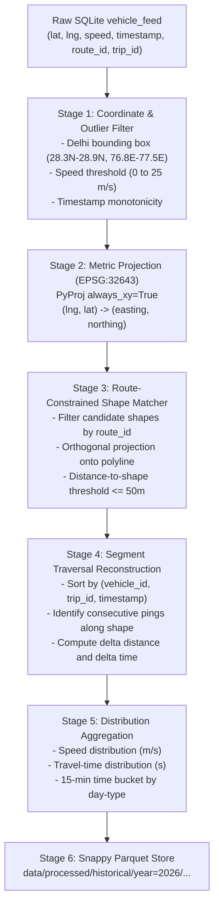

# PULSE — GPS Processing, Cleaning & Map-Matching Methodology
**Project:** Predictive Urban Mobility & Live Spatiotemporal Engine  
**Team:** HopCode | **Hackathon:** Transport Stack Hackathon 2026 (Problem 1)  
**Authoritative Architectural Alignment:** ADR 002, ADR 003, ADR 006  

---

## 1. Overview of the GPS Pipeline

The raw DTC GPS archive delivers approximately 30 million observations per day. Like all real-world AVL feeds, it contains duplicates, GPS teleportation anomalies, multipath reflection errors, stationary depot noise, and out-of-order pings.
The PULSE GPS processing pipeline converts raw coordinates into clean, route-aligned, metric segment traversals.



---

## 2. Stage-by-Stage Processing Protocol

### Stage 1: Coordinate Sanitization & Outlier Detection
- **Spatial Bounding Box**: Delhi NCR bounding box $[28.30^\circ \text{N}, 28.95^\circ \text{N}] \times [76.80^\circ \text{E}, 77.55^\circ \text{E}]$. Observations outside this box are tagged `OUT_OF_BOUNDS` and excluded.
- **Speed Clamping**: Maximum realistic urban bus speed is capped at $25\text{ m/s}$ ($90\text{ km/h}$). Observations with reported speed $> 25\text{ m/s}$ are flagged `SPEED_OUTLIER`.
- **Temporal Sorting**: Observations are ordered chronologically by `(vehicle_id, trip_id, timestamp)`. Negative time deltas ($\Delta t \le 0$) indicate out-of-order pings and are reconciled.

### Stage 2: Metric Cartesian Projection (ADR 003)
Geographic coordinates are transformed to **EPSG:32643 (UTM Zone 43N)** using PyProj:
```python
from pyproj import Transformer
transformer = Transformer.from_crs("EPSG:4326", "EPSG:32643", always_xy=True)
easting, northing = transformer.transform(longitude, latitude)
```
Properties of UTM Zone 43N for Delhi:
- Scale distortion is $< 0.04\%$ across the entire Delhi NCT.
- Euclidean distances in projected space directly correspond to meters.

### Stage 3: Route-Constrained Map Matching
Instead of performing unconstrained map-matching against the entire road network (which is computationally prohibitive and prone to bridge/flyover confusion), PULSE performs **route-constrained map matching**:
1. For an observation with `route_id`, identify all candidate GTFS `shape_id`s associated with that route via `trips.txt`.
2. Construct a Shapely spatial R-Tree index over the line segments of candidate shapes.
3. Project the point $(x, y)$ orthogonally onto candidate shapes:
   $$d_{\text{offset}} = \min_{p \in \text{shape}} \|(x, y) - p\|$$
4. Compute the linear reference distance $s_{\text{along}}$ (meters along the route from the origin).
5. If $d_{\text{offset}} > 50\text{ meters}$, the observation is rejected as `OFF_ROUTE_OUTLIER`.
6. Match confidence score is assigned:
   $$C_{\text{match}} = \max\left(0.0, 1.0 - \frac{d_{\text{offset}}}{50.0}\right)$$

### Stage 4: Route Segmentation & Traversal Reconstruction
1. GTFS shapes from `shapes.txt` are sliced into contiguous segments of length $L \in [300\text{m}, 500\text{m}]$.
2. Segment boundaries are snapped to nearby GTFS bus stops to separate stop dwell intervals from free-flow movement.
3. When a bus transitions from position $s_1$ at $t_1$ to position $s_2$ at $t_2$ within the same trip:
   - $\Delta d = s_2 - s_1$
   - $\Delta t = t_2 - t_1$
   - Calculated speed: $v_{\text{calc}} = \frac{\Delta d}{\Delta t}$
   - Dwell detection: if $v_{\text{calc}} < 0.5\text{ m/s}$ and proximity to a stop is $< 30\text{m}$, the interval is classified as `STOP_DWELL`.

### Stage 5: Dual Distribution Aggregation (ADR 002)
For each segment $s$, day-type $d \in \{\text{weekday}, \text{weekend}\}$, and 15-minute time bucket $b \in [0..95]$:
- Segment travel time $T_{\text{segment}} = \frac{L_{\text{segment}}}{v_{\text{eff}}}$ is recorded.
- We compute and persist robust summary statistics:
  - Median ($\tilde{T}$), 10th percentile ($T_{10}$), 90th percentile ($T_{90}$)
  - Median speed ($\tilde{v}$), $v_{10}$, $v_{90}$
  - Independent vehicle count ($N_{\text{veh}}$) and independent trip traversal count ($N_{\text{trip}}$)
