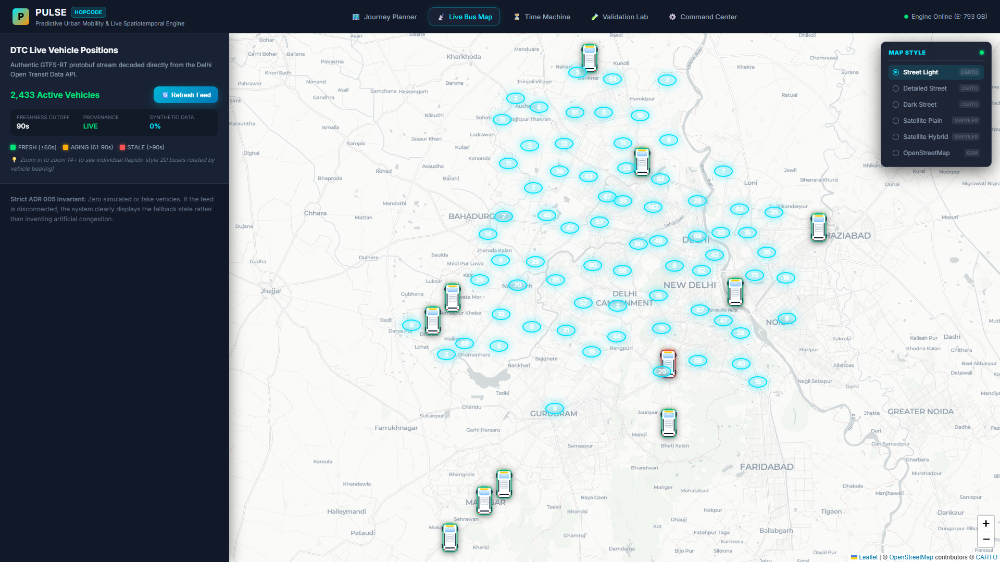
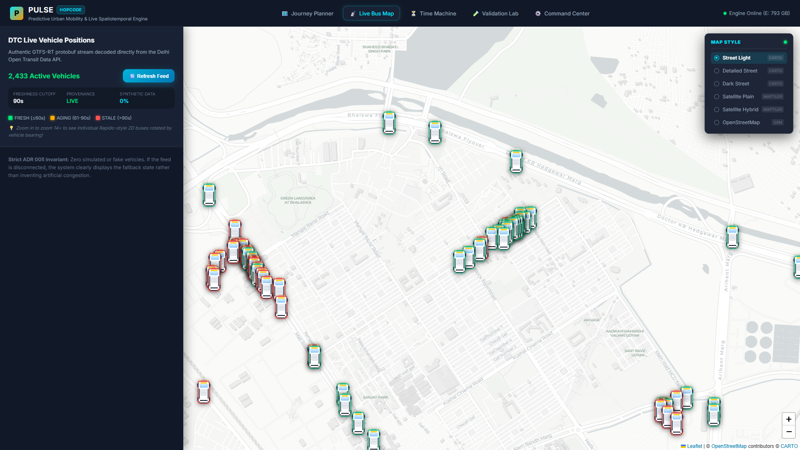
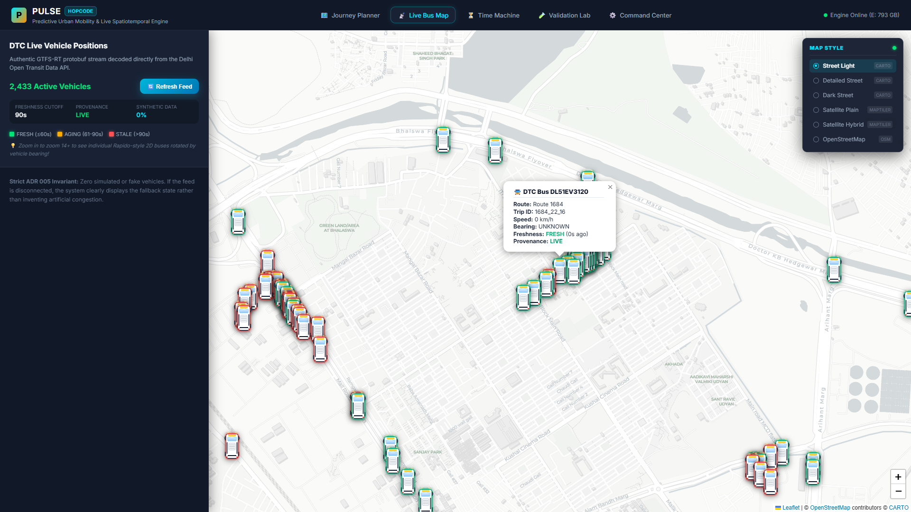

# PULSE — Live Vehicle Rendering & Rapido-Style 2D SVG Buses

## Overview
This document documents the authentic rendering of Delhi DTC live vehicles using custom 2D top-down SVG bus silhouettes, dynamic bearing rotation, and luminous status glows indicating observation freshness.

## 1. Rapido-Inspired 2D SVG Bus Architecture
- **Silhouette Geometry**: Created original top-down 2D bus SVGs with realistic proportions (`viewBox="0 0 64 120"`):
  - Rounded rectangular bus chassis with aerodynamic mirrors.
  - Front panoramic windshield and dual luminous headlights.
  - Tinted side passenger windows, emergency exit hatches, and rear tail-lights.
  - Four distinct rubber wheel arches.
- **Dynamic Rotation**: Rotated by the vehicle's actual bearing (`transform: rotate(${bearing}deg)`). When bearing is missing or 0, a distinct circular beacon mode is rendered.
- **Observation Freshness Classification (ADR 005)**:
  - **FRESH ($\le 60$s)**: Emerald glow (`#10B981`) and vibrant green chassis.
  - **AGING ($61-90$s)**: Amber glow (`#F59E0B`) and warm yellow chassis.
  - **STALE ($> 90$s)**: Crimson glow (`#EF4444`) and red chassis.
- **Clustering**: Below zoom level 14, vehicles are dynamically clustered into `.pulse-cluster` counters. At zoom 14+, clusters automatically dissolve into individual oriented 2D SVG bus vehicles.
- **Interactive Popup**: Clicking any bus marker displays vehicle registration (`vehicle_id`), route number, trip ID, speed in km/h, observation age in seconds, and corridor matching status.

## 2. Verified Browser Evidence
- **Live Bus Overview with Cluster Counters & Heat**:
  
- **High-Zoom 2D SVG Bus Silhouettes with Bearing Rotation & Glowing Headlights**:
  
- **Live Bus Vehicle Provenance Popup**:
  
