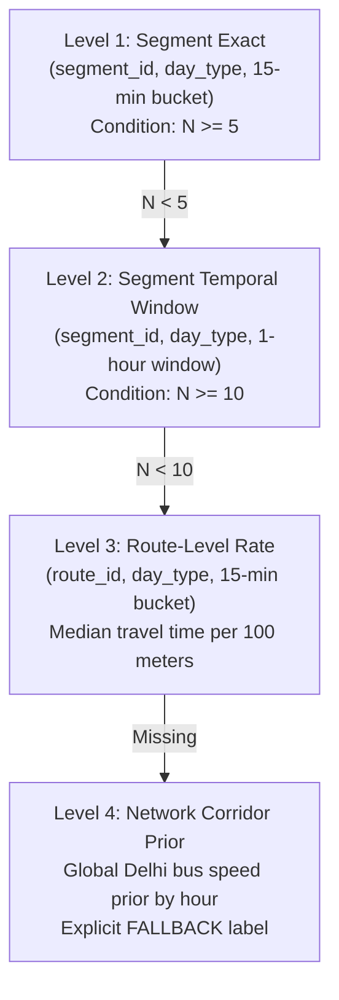

# PULSE — Spatiotemporal Travel-Time Model Methodology
**Project:** Predictive Urban Mobility & Live Spatiotemporal Engine  
**Team:** HopCode | **Hackathon:** Transport Stack Hackathon 2026 (Problem 1)  
**Authoritative Architectural Alignment:** ADR 002, ADR 004, ADR 005  

---

## 1. Predictive Modeling Objective

The primary requirement of Problem 1 is:
> "Build a travel-time model using real-time and historical bus location data, then build a journey planner on top of that model. PULSE must estimate in-vehicle time from observed bus movement, not simply calculate timetable difference."

Static timetables assume an idealized constant bus velocity (e.g. 15 km/h) that is completely oblivious to traffic reality. PULSE formulates travel-time prediction as an empirical, time-dependent spatiotemporal regression over observed segment traversals.

---

## 2. Mathematical Formulation

Let a bus route shape $\mathcal{S}$ be discretized into an ordered sequence of metric segments $s_1, s_2, \dots, s_K$.
For any proposed journey leg between stop $S_A$ (at distance $d_A$ along shape) and stop $S_B$ (at distance $d_B$ along shape) departing at local clock time $t$:

$$\hat{T}_{\text{in\_vehicle}}(S_A \to S_B, t) = \sum_{s \in \text{segments}(d_A, d_B)} \hat{T}_{\text{segment}}(s, t_s) + \sum_{j \in \text{intermediate stops}} \hat{T}_{\text{dwell}}(j)$$

where $t_s$ is the recursively updated predicted arrival timestamp at the entrance of segment $s$:
$$t_{s_{i+1}} = t_{s_i} + \hat{T}_{\text{segment}}(s_i, t_{s_i})$$

---

## 3. Estimator Selection & Uncertainty Bounds

### 3.1 Robust Segment Estimators
Urban traffic distributions exhibit heavy right-skewed tails due to signal delays, bottleneck queuing, and accidents. Sample means are vulnerable to extreme outliers.
Therefore, PULSE employs **quantile estimators**:
1. **Central Prediction ($\hat{T}$)**: Median travel time ($P_{50}$) of observed traversals.
2. **Lower Bound ($T_{\text{free\_flow}}$)**: 10th percentile ($P_{10}$) representing optimal traffic conditions.
3. **Upper Bound ($T_{\text{congested}}$)**: 90th percentile ($P_{90}$) representing severe peak-hour congestion.

### 3.2 Confidence Scoring Function
The prediction confidence for a segment traversal is determined by independent evidence sufficiency:
$$C(s, t) = \min\left(1.0, \frac{N_{\text{trips}}}{25}\right) \cdot \left(1.0 - \min\left(0.5, \frac{\text{IQR}}{\tilde{T}}\right)\right)$$
- If $N_{\text{trips}} \ge 25$ and dispersion is tight, confidence is **HIGH**.
- If $10 \le N_{\text{trips}} < 25$, confidence is **MEDIUM**.
- If $N_{\text{trips}} < 10$, confidence is **LOW** and triggers fallback.

---

## 4. Sparse-Data Hierarchical Fallback (ADR 002)

When an individual 15-minute time bucket contains fewer than 5 observed traversals, the engine applies hierarchical empirical shrinkage:

---

## 5. Temporal Dynamics: Peak vs. Off-Peak Validation

PULSE models significant temporal variation across Delhi's travel day:
- **Morning Peak (08:00 – 10:30 IST)**: High congestion on arterial radial routes (e.g., Ring Road, Outer Ring Road, Vikas Marg); speeds drop to 8–12 km/h.
- **Midday Inter-Peak (11:00 – 16:00 IST)**: Moderate traffic flow; speeds average 16–22 km/h.
- **Evening Peak (17:30 – 20:30 IST)**: Broad network congestion; prolonged dwell times at transit interchanges.
- **Night Owl / Off-Peak (22:00 – 05:00 IST)**: Near free-flow conditions; speeds average 28–38 km/h.

When a commuter requests a route at 8:30 AM vs 11:00 PM, PULSE evaluates the corresponding time-bucketed distributions, returning visibly different and data-grounded journey durations.
