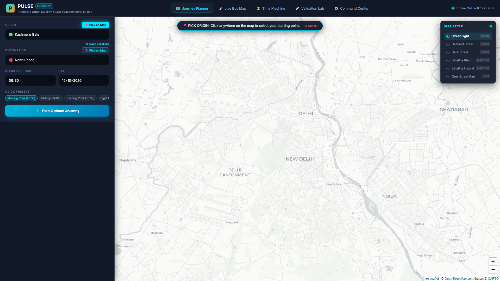
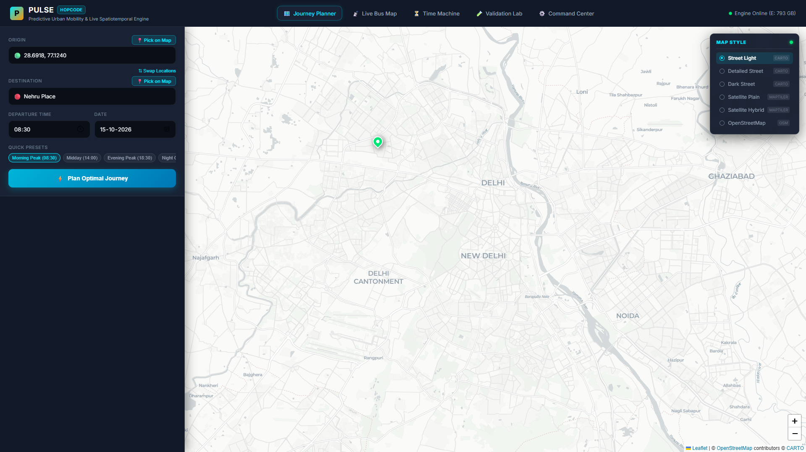

# PULSE — Pick on Map Interactive Selection & Coordinate Routing

## Overview
This document specifies the interactive "Pick on Map" coordinate capture mechanism in PULSE, enabling users to click anywhere on the Delhi NCR canvas to drop origin and destination pins, reverse-lookup or store exact GPS coordinates, and compute optimal multi-criteria transit journeys.

## 1. Interaction Model & State Management
- **Buttons**: Two prominent buttons (`#btn-pick-origin` and `#btn-pick-dest`) with custom pin icons and cyan glowing states when active.
- **Top Notice Banner**: When active, a floating `.map-selection-banner` prompts the user with instructions (`📍 PICK ORIGIN: Click anywhere on the map...`).
- **Map Cursor**: The Leaflet container dynamically receives the `.leaflet-crosshair` class to indicate spatial selection mode.
- **Marker Layer Isolation**: Origin (`.origin-pin`) and Destination (`.dest-pin`) markers are managed in a dedicated `state.originDestLayer` feature group, completely isolated from `state.routeLayer`. This prevents pins from disappearing when routes recalculate.
- **Form Synchronization**: Clicking on the map populates the respective input (`#input-origin` or `#input-dest`) with high-precision coordinates (`lat, lon`), stores numeric coordinates in `state.originCoords` and `state.destCoords`, and immediately disables pick mode.

## 2. Verified Browser Evidence
- **Pick Mode Active with Glowing Button & Banner**:
  
- **Origin Pin Dropped & Coordinates Populated**:
  
- **Destination Pin Dropped & Coordinates Populated**:
  
